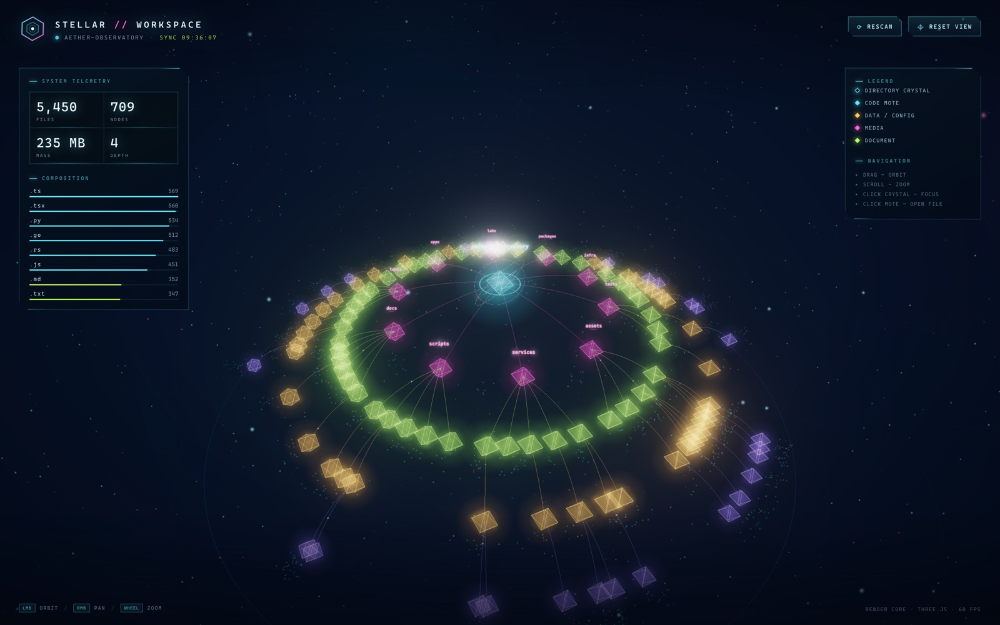
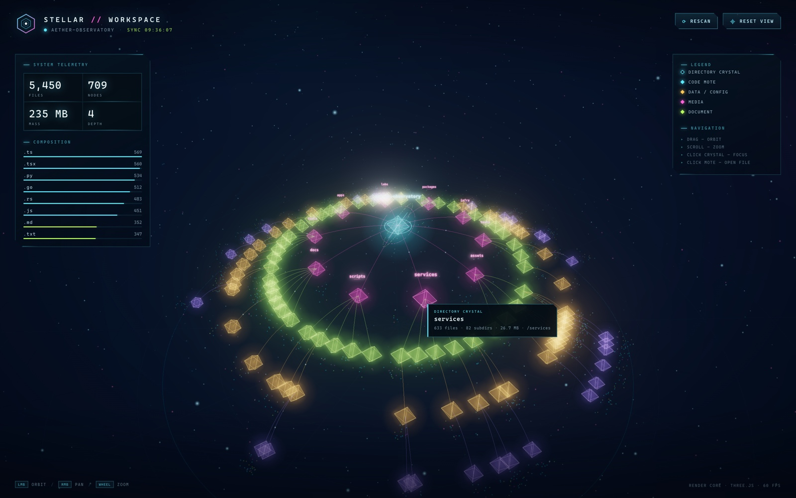
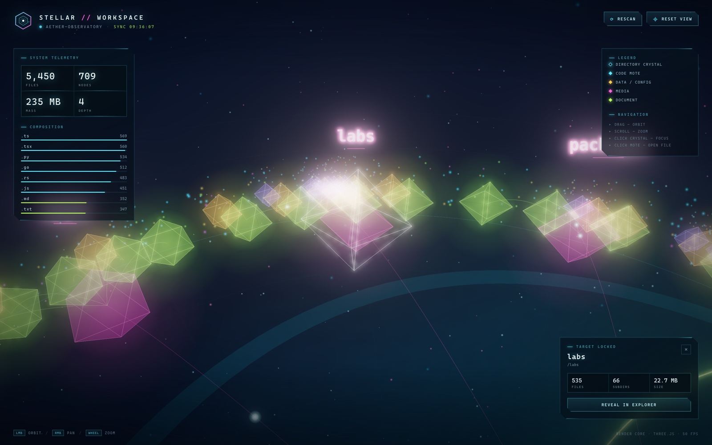

<h1 align="center">◈ Stellar Workspace</h1>

<p align="center">
  <strong>Your codebase, as a small galaxy.</strong><br/>
  A sci-fi 3D workspace visualizer for VS Code.
</p>

<p align="center">
  
  
  
</p>

<p align="center">
  Folders become glowing crystal nodes. Files become orbital data motes.<br/>
  A live telemetry HUD tells you exactly what you are looking at.
</p>



## ✨ Highlights

- **Living star map** — the workspace root is a pulsing core; every directory is a wireframe crystal arranged in depth rings and connected by luminous data curves.
- **File motes** — files orbit their folder as additive particles, colour-coded as code, data/config, media, or documentation.
- **Cinematic rendering** — slow auto-orbit, starfield, nebulae, a polar grid, travelling data pulses, a scanning ring, and filmic bloom.
- **Telemetry HUD** — files, nodes, total size, depth, and an extension-composition chart. Scan limit breaches are surfaced with a truncation badge.
- **Hover & focus** — hover any crystal or mote for intel, click a crystal to fly to it and reveal it in Explorer, click a mote to open the file.
- **Local & private** — everything is scanned and rendered inside the webview. No network calls, no telemetry, no fonts fetched from the internet.

## 🔭 A closer look

| Hover for intel | Lock a target |
| --- | --- |
|  |  |
| Hover any node for files, subdirectories, size and path. | Click to focus, then reveal the folder in Explorer. |

## 🚀 Quick start

### Install a packaged build

If you have `stellar-workspace-0.0.1.vsix` — build one with `npm run package` if not:

```bash
code --install-extension stellar-workspace-*.vsix
```

Then open the Command Palette and run **Stellar Workspace: Open 3D Workspace Map**, or click **STELLAR** in the status bar.

### Run from source

```bash
cd stellar-workspace
npm install
npm run build
```

Open the folder in VS Code and press **F5** to launch the Extension Development Host. In that window, run:

> **Stellar Workspace: Open 3D Workspace Map**

For iterative development:

```bash
npm run watch   # rebuild extension + webview on save
npm run check   # type-check without emitting
npm run package # produce a .vsix
```

## 🎮 Controls

| Input | Action |
| --- | --- |
| Drag | Orbit the camera around the core |
| Right-drag | Pan the view |
| Scroll | Zoom |
| Hover | Show directory or file intel |
| Click a crystal | Focus the camera and open the target panel |
| Click a file mote | Open that file in the editor |
| Rescan | Re-walk the workspace and rebuild the map |
| Reset view | Fly back to the default framing |

## 🧠 How it works

1. **Scan** — a bounded recursive walk collects directories and files, skipping dotfiles and heavy folders such as `node_modules`, `dist`, `target`, and `vendor`.
2. **Lay out** — each directory receives an angular slice of a radial tree, proportional to its descendant file count. Depth becomes both radius and vertical offset, forming the funnel.
3. **Render** — three.js draws crystals, connection curves, sampled file motes, and labels; UnrealBloom and ACES tone mapping finish the frame.
4. **Interact** — raycasting picks crystals and point motes, drives tooltips, and posts open/reveal commands back to the extension host.

## 🗂️ Project structure

| Path | Role |
| --- | --- |
| `src/extension.ts` | Commands, webview lifecycle, message bridge, open/reveal actions |
| `src/scanner.ts` | Bounded recursive workspace scan and statistics |
| `src/types.ts` | Shared extension ↔ webview contracts |
| `webview/scene.ts` | three.js scene, radial layout, bloom, raycasting, camera fly-to |
| `webview/main.ts` | HUD wiring, composition chart, tooltips, target panel |
| `webview/style.css` | HUD, panels, loader, scanlines and responsive layout |
| `esbuild.js` | Bundles the extension host and the webview |

## ⚠️ Scan limits

To keep the map responsive, the scanner:

- skips dotfiles and common build/dependency directories,
- caps scans at ~3,500 files and 10 levels deep,
- displays up to ~140 directory crystals, prioritising the biggest branches,
- samples file motes per directory instead of drawing every file.

If a scan limit is hit, the HUD shows a **TRUNCATED SCAN** badge. Multi-root workspaces map the first folder.

## 🛣️ Roadmap

- [x] Radial 3D map with bloom, particles and HUD
- [x] Hover intel, camera focus, file opening, folder reveal
- [ ] Search and filter by extension or path
- [ ] Animated rescans with added/removed diffs
- [ ] Alternate layouts: force-directed, treemap city, spiral
- [ ] Export the map as PNG or SVG

## 🤖 Releasing

Releases are automated by [`.github/workflows/release.yml`](.github/workflows/release.yml) on every push to `main`. The workflow reads conventional commits since the last `v*` tag:

| Commit | Version bump |
| --- | --- |
| `feat:` | minor |
| `fix:`, `perf:`, `revert:` | patch |
| `feat!:`, `BREAKING CHANGE:` | major |

It bumps the version, builds the VSIX, pushes a `chore(release): vX.Y.Z [skip ci]` commit and tag, then publishes a GitHub Release with the VSIX attached. Documentation and chore-only pushes do not trigger a release. Run the workflow manually from the Actions tab to force a check.

## 📄 License

MIT © Xeronith. Built with [three.js](https://threejs.org) — no external assets, no tracking.
